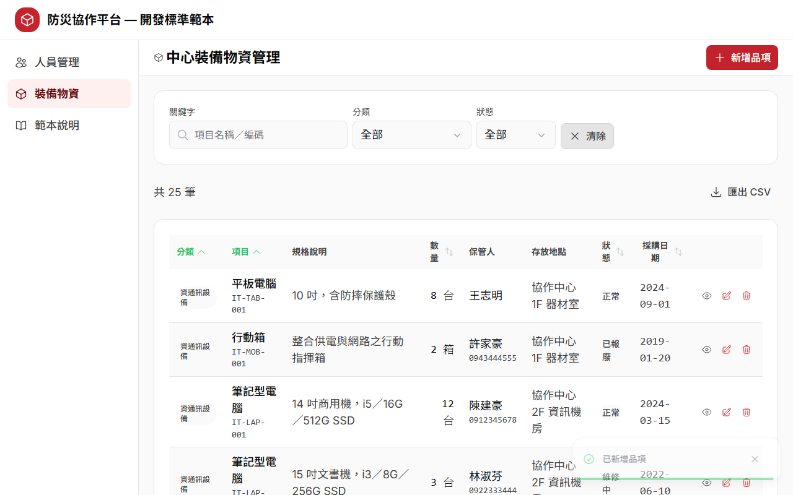
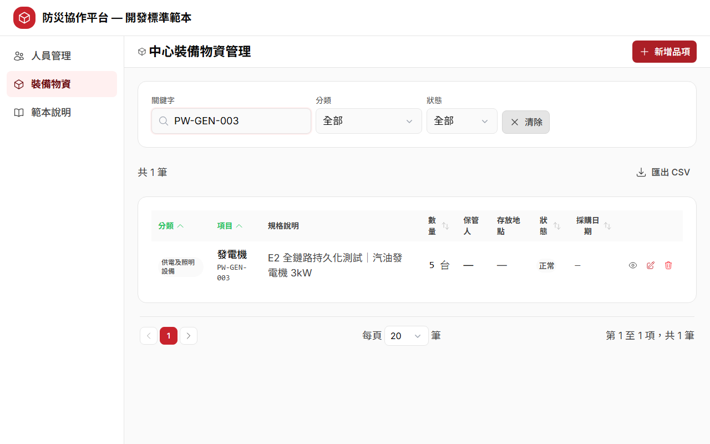

# AI CRUD Workshop Backend EASY｜學生／講師雙角色實跑評估報告

評估日期：2026-07-15（Asia/Taipei）  
後端版本：`AI_CRUD_Workshop_Backend_EASY` commit `62231e7`  
前端基線：`AI_CRUD_Workshop_Frontend_EASY` commit `4bdee60`  
評估範圍：harness、標準範本、學生教材、講師教材、checkpoint、LOOP、前後端全鏈路 E2E 與操作截圖

## 一、執行摘要

**結論：目前可進行講師帶領的內部小班試教；修完 3 項 P1 並取得真人 dry run 數據後，才建議作為正式新人標準課程。**

這一版最重要的技術風險已經修掉：Step 4 預設綁定學生的 `my-equipment-api`，沒有學生作品時會 exit 1，不再用官方解冒充全綠；講師 checkpoint 也會實際驗證 build、89 tests、24 筆 API 與 `ai_crud_equipment` DB。實跑結果可信，前後端全鏈路 6/6、LOOP 紅→綠、隔離資料庫與服務 teardown 都成功。

現在主要問題落在「新人照著教材能不能一次做對」：有兩個學生會直接複製的 PowerShell／dotnet 指令實測失敗；`instructor/` 與 `solution-api/` 雖文字上要求別偷看，實體仍與學生包放在一起且學生 README 直接連到答案；120 分鐘仍沒有真人 P50／P90 數據。

### 綜合評分

| 面向 | 分數 | 判定 |
|---|---:|---|
| Harness | 88/100 | 規則入口清楚、Agent 相容性佳；需要瘦身與發佈隔離 |
| 後端標準範本 | 90/100 | 可跑、可測、契約與 DB 防呆完整；正式環境邊界需再醒目 |
| 學生教材 | 79/100 | 主線清楚、救援 prompt 好用；仍有可複製指令錯誤與答案洩漏 |
| 講師教材 | 87/100 | 時間軸、停損與 checkpoint 很實用；缺真人節奏數據 |
| 自動驗收／證據鏈 | 94/100 | fail-closed、路徑與 DB 可追溯、6 條全鏈路與 5 張截圖 |
| 簡單扼要／新人友善 | 74/100 | 核心其實簡單，但資料夾與附錄量太大，主線易被淹沒 |
| **總評** | **86/100** | **有條件可試教** |

## 二、與前端 EASY 課程的銜接

本課不是另一套獨立 CRUD，而是前端課的正確續集：前端先教學員用 Nuxt mock 做出 24 筆裝備物資，再由後端課把同一份 13 欄契約接到 .NET API 與 PostgreSQL。

本次先實跑前端基線：

| 驗證 | 結果 |
|---|---|
| `Frontend_EASY/step0_course_intro/preflight.ps1` | 10 項 PASS，exit 0 |
| Node／pnpm | Node 24.13.0／pnpm 10.33.0 |
| 前端 solution-app | `http://localhost:3100/equipment/crud` 回 200 |
| 前端 mock E2E | 7 passed／0 failed／0 skipped，exit 0 |
| 前端課的學習終點 | CRUD、篩選、驗證與回歸都會動，但 reload 回到記憶體種子 |

後端課的全鏈路測試則明確驗證：新增、更新、刪除後 reload 仍反映 PostgreSQL 狀態，並用 APIRequestContext 直接查後端回應。兩課的學習差異具體且容易讓新人理解：**前端課學畫面與互動，後端課學契約、持久化與驗證責任。**

## 三、學生角色操作紀錄

### 3.1 從唯一入口開始

執行：

```powershell
cd step0_course_intro
powershell -ExecutionPolicy Bypass -File .\preflight.ps1
```

結果：exit 0；.NET 10.0.101、PostgreSQL 5432、`postgres/12345`、5080、3199、Node、pnpm、磁碟、ExecutionPolicy、Agent、E2E 依賴均可用。唯一 WARN 是 `psql` 不在 PATH，但腳本找到 `C:\Program Files\PostgreSQL\18\bin\psql.exe`，且帳密驗證成功。

學生體驗判定：入口短、錯誤分級清楚、修復提示具體，適合新人。

### 3.2 玩標準範本

執行：

```powershell
cd step2_speedrun_kit\2.5_sample_api\sample-api
dotnet test CrudTemplate.sln --nologo --verbosity minimal
```

結果：`49 passed / 0 failed / 0 skipped`，exit 0。範本包含單元與 WebApplicationFactory 整合測試、測試庫 `_test` 防呆、migration 與 24 筆種子。

### 3.3 建立學生工作區

依教材執行：

```powershell
Copy-Item -Recurse step2_speedrun_kit\2.5_sample_api\sample-api step3_new_module\my-equipment-api
Copy-Item step3_new_module\PRD-中心裝備物資-後端.md step3_new_module\my-equipment-api\
```

六個必要檔都存在：`CLAUDE.md`、`AGENTS.md`、`CODE-RULES-api-本專案.md`、`contract-conventions-summary.md`、`使用說明-複製範本開發新API模組.md`、PRD。`docs/baseline/` 也在工作區內，舊審查的失效相對路徑問題已修正。

### 3.4 驗證「沒有學生作品不能假綠」

在 `my-equipment-api` 尚未建立前直接跑：

```powershell
cd step4_loop_e2e
powershell -ExecutionPolicy Bypass -File .\run-e2e.ps1
```

結果：exit 1，明確顯示找不到 `my-equipment-api`，並說明 `-UseCheckpoint` 只證驗收／LOOP、不證學生生成完整度。這是正確的 fail-closed 行為。

### 3.5 參考解與學生工作區驗收

參考解：`89 passed / 0 failed / 0 skipped`，exit 0。  
套 checkpoint 後的學生工作區：同樣 89/89，且下一節四項自動驗收全過。

### 3.6 LOOP 紅→判因→修→綠

對象是學生工作區，不是官方解：

| 階段 | 實際結果 |
|---|---|
| 基準 | Equipment validation 23/23 綠 |
| 注入 | 將 qty 的 `[Range(0, ...)]` 註解，腳本備份原檔 |
| 紅 | `EV4_數量負值_失敗` 失敗；1 failed／22 passed，exit 1 |
| 判因 | App 的 DTO 驗證下限被移除；單元測試不碰 DB，排除測試環境與 DB |
| 修 | `restore.ps1` 精準還原並更新 timestamp |
| 綠 | 23/23 綠；備份已清除；`[Range]` 規則已復原 |

這一段符合新人訓練需要：紅燈可預期、根因單一、可還原、不靠改鬆測試換綠。

## 四、講師角色操作紀錄

### 4.1 85 分鐘 checkpoint 實跑

執行：

```powershell
cd instructor
powershell -ExecutionPolicy Bypass -File .\apply-solution-checkpoint.ps1 `
  -Target ..\step3_new_module\my-equipment-api
```

實際套用：新增 17 檔、覆蓋 6 檔，原檔備份至 `.checkpoint-backup/`。它不只補 API，也補 Equipment 單元／整合測試、test factory、delta 文件與正確 DB 設定。

四項機器驗收：

| Gate | 結果 |
|---|---|
| build | exit 0；0 warning／0 error |
| test | TRX 解析 passed=89／failed=0 |
| API | `GET /api/equipment/items` 回 24 筆 |
| DB | 設定為 `ai_crud_equipment`，psql `current_database()` 相符 |

講師體驗判定：checkpoint 已從「救程式片段」升級為「救回可驗收基準」，且任何 gate 失敗都 exit 1，適合課堂停損。

### 4.2 學生作品全鏈路

`run-e2e.ps1` 印出的實際被測路徑為：

```text
D:\AIWORK\_AICLASS\AI_CRUD_Workshop_Backend_EASY\step3_new_module\my-equipment-api
```

被測 DB 為 `ai_crud_equipment_e2e`。腳本重建隔離 DB、自行啟 API 5080、前端 3199、跑 Chromium、最後 teardown。結果：`6 passed / 0 failed / 0 skipped`，exit 0，5080／3199 均已釋放。

六條測試涵蓋：Read 24 筆、Create reload 持久化、後端編碼格式、Update reload、Delete reload、前端新增後可由 API 直接查回。

## 五、操作截圖證據鏈

以下五張皆由本次 `run-e2e.ps1` 的真實 Chromium 執行重新產生，不是示意圖。in-app Browser 當時沒有可用分頁，因此畫面證據採課程本身的 Playwright 截圖；功能與 DB 結果另由測試與 psql 交叉驗證。

### 1. API 模式初始列表：PostgreSQL 種子 24 筆


### 2. 新增表單已填妥，編碼預覽 `PW-GEN-003`


### 3. 儲存後列表變 25 筆



### 4. Reload 後仍可查到同一筆



### 5. 刪除並 reload 後查無


本次檔案時間均為 2026-07-15 11:24，尺寸 1280×800。

## 六、Harness 評估

### 值得定為標準

1. **單一入口**：Codex 讀 `AGENTS.md`，再指向 `CLAUDE.md`；Claude／其他 Agent 也有明確入口。
2. **規則可驗收**：薄 Controller、Service 邊界、DTO 驗證、Mapperly、`ModelResult`、狀態碼、migration、測試紀律都能在程式或測試中查證。
3. **工作區自包含**：baseline SRS／SDD 已複製進 `docs/baseline/`，Agent 不必跳出專案猜路徑。
4. **需求先裁決**：PRD → 5–7 題選擇題 → SRS/SDD delta → TASKS → 開工，適合教新人先定範圍。
5. **不把 workflow 當成 harness 成效**：教材已正確區分「AI 會先問」是 prompt 遵循，「程式分層／驗證／測試」才是 harness 成效。

### 改善點

- 學生主線只需要「四件＋AGENTS」，但資料夾同時包含完整 `aspnet-api-ai-harness-v5`、UI 模組與大量附錄。建議發佈時把深度內容移到 `appendix/`，主線只露出 5 個入口檔。
- `CLAUDE.md`、CODE-RULES、contract summary 有必要的重疊，但新人容易以為都要背。每份首頁應固定標示：「必讀 5 分鐘／查表用／課後深讀」。
- 「像資深工程師、敢上線」的措辭宜收斂成「可進 code review／測試環境」；本課明文沒有認證授權且用 DEMO superuser 帳密，不應讓新人把範本誤認為 production-ready。

## 七、標準範本評估

### 優點

- 49 tests 的人員範本與 89 tests 的裝備參考解均全綠；Mapperly RMG 警告升級為錯誤。
- `GET 200 / POST 201+Location / PUT 200 / DELETE 204 / 400 / 404 / 500` 契約完整。
- JSON camelCase、DB snake_case、DataAnnotations、CHECK constraint、唯一索引與 migration 有一致來源。
- 測試資料庫必須 localhost 且名稱以 `_test` 結尾，`EnsureDeleted` 前有防呆。
- id 用 PostgreSQL SEQUENCE；種子冪等；全域例外不洩漏 `ex.Message`。

### 邊界

- Equipment code 採「同前綴 MAX+1＋唯一索引」，文件誠實標為單寫入者前提；併發撞號會落到 500。課堂可保留簡化，但公司標準版應改為 per-prefix counter／advisory lock，或捕捉 unique violation 後有限重試並回 409。
- 固定 `postgres/12345` 與無 JWT 只適用本機教室。雖 SETUP 已有警語，建議在 Swagger 頁與 Step 5 再放一個「禁止直接部署」紅框。
- 全量 GET、前端分頁適用 `<1000` 筆假設。公司範本應有啟用 server-side paging 的明確升級門檻。

## 八、目前應修問題

### P1｜下一次正式試教前

#### P1-1　兩個可複製指令實測會失敗

1. `PROMPTS.md` 使用：

   ```powershell
   dotnet run --project src --urls http://localhost:5080
   ```

   實跑回「找不到要執行的專案」。應改為：

   ```powershell
   dotnet run --project src\CrudTemplate.Api --urls http://localhost:5080
   ```

2. 兩份 `使用說明-複製範本開發新API模組.md` 使用：

   ```powershell
   Select-String -Path src -Pattern "Member|template" -Recurse
   ```

   PowerShell 回「找不到參數 Recurse」。應改為：

   ```powershell
   Get-ChildItem src -Recurse -File | Select-String -Pattern 'Member|template'
   # 或本課既然已使用 rg：rg -n 'Member|template' src
   ```

建議加 `verify-doc-commands.ps1`，至少自動驗 README／PROMPTS 中的關鍵命令。

#### P1-2　學生包與答案包沒有實體隔離

學生 README 雖要求完成後才看 SCOPE，但同一份教材中 `../instructor/SCOPE-後端課堂範圍決策.md` 可直接點開，`solution-api/` 也在旁邊。這只靠自律，不是可評量的盲測。

建議發佈三包：

- `student-kit`：step0～step5、sample-api、PRD、prompts，不含答案／solution。
- `instructor-kit`：GUIDE、SCOPE、checkpoint、restore。
- `checkpoint-kit`：由講師在 85 分鐘後才解鎖。

#### P1-3　120 分鐘仍無真人證據

本輪證明機器流程可跑，不能取代新人的閱讀、Agent 等待、釐清與修錯時間。至少找 3 位符合先備條件的新人，記錄每段 P50／P90、求助次數、checkpoint 使用率、完成率；P90 超過 120 分就改為 150 分或把安裝與 Step 2 閱讀移至課前。

### P2｜教材品質與維護

1. `step2/2.1_play_template/README.md` 仍有 4 個截圖 placeholder；HANDBOOK 目前只有 Step 4 的 5 張圖。應補 Swagger 五路由、201+Location、400 camelCase、49 tests。
2. `fullchain-app/使用說明-複製範本開發新模組.md` 首頁說 3000/3001 應改 3100，但正文仍有多個 `localhost:3000`。即使是附帶的前端舊手冊，也會讓新人照錯埠號。
3. `solution-api/SETUP.md` 與複製後的 `my-equipment-api/SETUP.md` 仍使用 `cd sample-api`，且前言引用舊包裝路徑／舊 SRS 版本；應改成「在目前專案根目錄」的相對指令。
4. 根目錄舊的 `COURSE_REVIEW_TEACHER_STUDENT.md` 是修正前報告，仍寫 HANDBOOK 缺檔、Step 4 綁官方解等已解決問題；前端 repo 也有相同情況。應標示「歷史審查」或以本報告取代，避免講師誤判現況。
5. Step 1 的 A/B 現在已誠實標為策展成品並附 12 項現場計分表，方向正確；下一步可把每次實測的 model／date／分數追加到一張小表，逐梯累積資料。
6. 建議加入 CI：Markdown 連結、禁用錯誤 port、禁止 `Select-String ... -Recurse`、必要測試數與 screenshot manifest。此次掃描前後端共 172 份 Markdown，本地相對連結 0 失效，但命令語意與內容漂移不是 link checker 能抓到的。

## 九、建議的「新人標準」：只教三道 Gate

要讓課程簡單扼要，主線不要用「五個 Step、很多文件」來記；改成三道 Gate：

| Gate | 新人要做什麼 | 必交證據 |
|---|---|---|
| 1. 規格 Gate | PRD → 六題裁決 → SRS/SDD delta → TASKS | 六題答案＋理由、任務清單 |
| 2. 程式 Gate | 套用 harness／範本，完成 Entity→migration→DTO→Mapper→Service→Controller→seed→tests | build 0/0、測試全綠、Swagger 狀態碼、psql 資料 |
| 3. 交付 Gate | LOOP 紅→判因→修→綠，再跑學生工作區全鏈路 | 紅／根因／修法／綠、E2E 被測 path、DB name、6/6、截圖 |

這三道 Gate 既是課程記憶點，也可直接變成公司的 PR checklist。深度 SRS、完整 harness、架構圖與設計決策都放附錄，現場只在需要時查。

### 建議 120 分鐘節奏

前提：課前已跑 preflight、安裝 Chromium、登入 Agent；每人有獨立工作區。

| 時間 | 活動 | 可觀察產出 |
|---:|---|---|
| 0–8 | 目標＋前端 mock 對照 | 能說出「reload 消失 vs DB 持久化」 |
| 8–18 | Harness A/B | 指出至少 3 個規則與風險因果 |
| 18–35 | 玩 sample API | Swagger CRUD＋49 tests |
| 35–45 | 四件 harness＋複製／共用區 | 說得出哪些能複製、哪些不能動 |
| 45–60 | PRD 六題裁決 | 六題答案＋每題一句理由 |
| 60–78 | AI 產 delta／TASKS，講師 review | 任務範圍無偷加漏做 |
| 78–88 | AI 實作；落後者套 checkpoint | 學生 API 可 build |
| 88–101 | 四路驗收 | 0/0、89 tests、24 API、正確 DB |
| 101–112 | LOOP 紅→綠 | 四項 LOOP 證據 |
| 112–118 | 全鏈路 E2E | 學生 path＋DB＋6/6＋截圖 |
| 118–120 | Exit ticket | 回公司第一個要落地的 Gate |

## 十、正式開課 Gate

### 現在

- 可：6–10 人、講師高度介入、內部試教。
- 不建議：無講師自學、對外正式課、宣稱保證 120 分鐘完成。

### 正式發佈前必須同時成立

- P1-1 指令錯誤全修並由乾淨機器重跑。
- 學生／講師／checkpoint 三包分離。
- 至少 3 位新人 dry run，P90 在宣稱時限內。
- 文件 CI 全綠，舊審查標為歷史。
- 每一份綠燈證據都印學生 project path 與 DB name；使用 checkpoint 必須標記。

## 十一、本輪驗證清單

| 項目 | 結果 |
|---|---|
| 前端 preflight | PASS |
| 前端 mock E2E | 7/7 PASS |
| 後端 preflight | PASS（1 WARN：psql 未在 PATH，但找到絕對路徑） |
| sample-api | 49/49 PASS |
| solution-api | 89/89 PASS |
| checkpoint 自動驗收 | 4/4 PASS |
| 預設 E2E 缺學生作品 | 正確 FAIL，exit 1 |
| 學生工作區 fullchain | 6/6 PASS |
| LOOP | 23 綠 → 1 紅/22 綠 → 23 綠 |
| Screenshot | 5 張重新產生 |
| 前後端 Markdown 本地連結 | 172 檔，0 broken |
| 服務清理 | 3100／3199／5080 均已釋放 |

整體而言，這套課程現在已經有可信的工程閉環。下一步不需要再增加更多內容，而是把主線縮成三道 Gate、把答案真正隔離、把所有可複製指令變成可自動驗證，並用真人數據決定課程時長。
