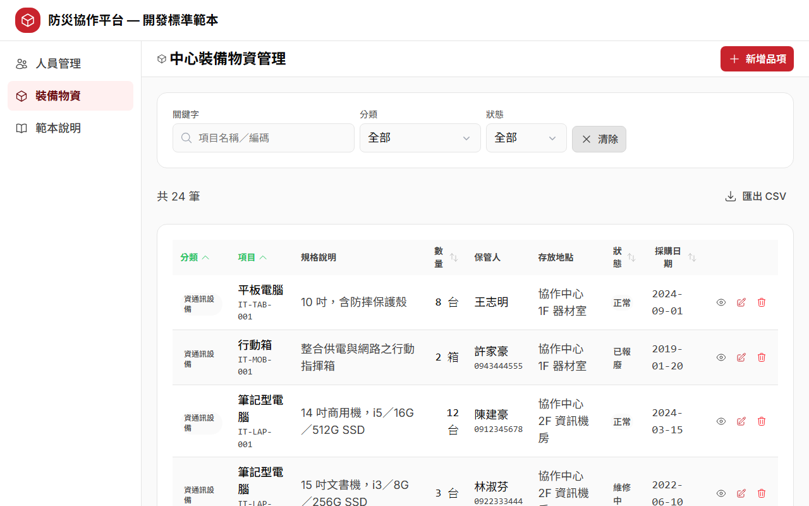
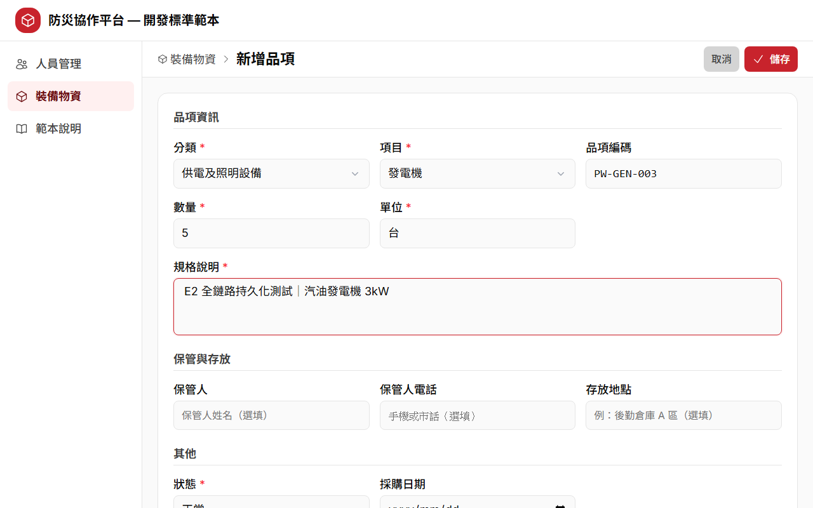
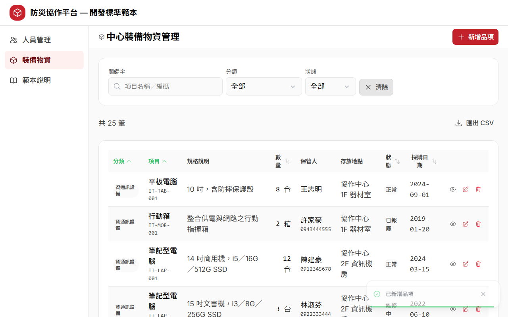
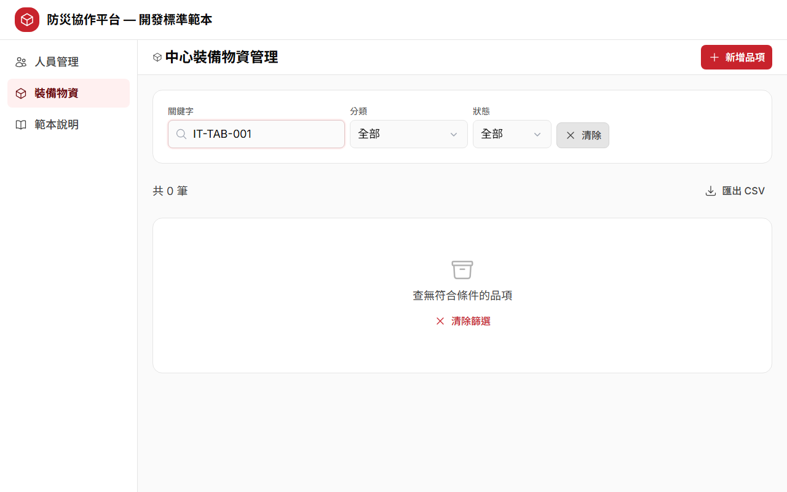

# AI CRUD 工作坊 Backend EASY 版 — Step-by-Step 學習手冊

> **一句話**：把假資料變真的——用「.NET CRUD 範本 + AI harness + AI」把上一堂前端課的裝備物資模組，接上真的 .NET API 與 PostgreSQL。課程目標：讓新模組的後端骨架（API + 資料表 + 測試）在一小時內長出來（依 AI Agent 與網路情況而異）。
>
> 這份手冊帶你把整堂課從頭走一遍。每一步都有「要做到什麼、怎麼做、會看到什麼、常見坑」，課後照著走也能自己重現。

## 這堂課的靈魂：持久化

前端課的裝備物資模組是**記憶體 mock**——按 F5 重整，剛新增的資料就消失了。這堂課要把它**變成真的**：資料寫進 PostgreSQL，**F5 之後還在、換一台電腦也還在**。

| | 前端 mock（上一課） | 本課：真後端 |
|---|---|---|
| 資料放哪 | 瀏覽器記憶體 | PostgreSQL 資料表 `equipment_item` |
| 按 F5（reload）後 | 改動消失、重置回 24 筆種子 | **改動仍在**（真的落庫） |
| 編碼 `PW-GEN-003` 誰算 | 前端算 | **後端**在交易內算（前端只做預覽） |
| 怎麼證明 | 看畫面就夠 | 看畫面 **＋** 直接打 API 拿 JSON 對證 **＋** psql 查表 |

> 整堂課請記住兩句話：
> 1. **後端課的靈魂是持久化**——F5 還在，才叫真的。
> 2. **每一盞綠燈都必須來自你自己的作品**（`my-equipment-api`），不是官方參考解偷跑。

## 課程大綱

全程動手做，不是聽簡報。總時間約 **120 分鐘**（目標值，非承諾），照順序走、不要跳步——後面會用到前面的產出。

| Step | 這一章在做什麼 | 時間 |
|------|--------------|:---:|
| step0 | 課程說明、前置檢查（11 項） | 10 分 |
| step1 | 為什麼要 harness（同一句後端需求，有／沒有 harness 的產出對比） | 10 分 |
| step2 | 後端快速完工秘笈（玩範本 API → 系統文件 → harness 四件 → 分層架構＋DB → 範本程式） | 35 分 |
| step3 | 複製範本開發新模組（真實 PRD → AI 釐清選擇題 → 生成 SRS/SDD-delta／API／Migration／測試）**← 重頭戲** | 40 分 |
| step4 | 後端 LOOP 工程（紅→判因→修→綠）＋前後端全鏈路 E2E | 20 分 |
| step5 | 課程總結、評量量表、回去怎麼用 | 5 分 |

**這門課給誰**：會寫程式、想學「用 AI 快速生出一支有規矩的後端 API」的工程師。你需要會用 PowerShell、對 REST API 有基本概念、看得懂 C# 大意；**不需要** .NET／EF Core／PostgreSQL 實作經驗，也不需要提示詞經驗。上過前端 EASY 課最有感（直接把那個 mock 前端接上真後端），沒上過也可以——step4 附現成前端成品。

---

## 請求的一生（先建立整體感）

動手前先記住這條動線。這堂課做的每一件事，都是在這條線上補齊某一段：

```
瀏覽器（前端頁面）
   │  useFetch('/api/equipment/items')
   ▼
Nuxt devProxy（前端轉呼叫，避開跨網域）
   │  HTTP GET/POST/PUT/DELETE
   ▼
Controller（薄委派，只做「呼叫 Service → 對映狀態碼」）
   │
   ▼
Service（商業邏輯全在這：產 id、算 code 編碼、查無回失敗）
   │
   ▼
EF Core（把物件翻成 SQL，參數化、防注入）
   │
   ▼
PostgreSQL（資料表 equipment_item，真正落地的地方）
   │  一筆一筆存著，F5 不會消失
   ▼
   原路回來 → JSON → 前端畫面
```

前端課只做到「瀏覽器」那一格（資料在記憶體）；這堂課把 **devProxy → Controller → Service → EF → PostgreSQL** 這一整段接起來。**資料在 PostgreSQL 裡查得到，才叫真的持久化。**

---

## Step 0｜課程說明與前置檢查

### 🎯 這一步要做到

1. 知道這門課要教什麼、怎麼進行（把假資料變真的）。
2. 確認你的機器準備好了：.NET SDK、PostgreSQL、埠號、磁碟等 **11 項**全過。

### 👣 跟著做

1. 讀一遍 `step0_course_intro/START_HERE.md`，確認上完課要帶走三件能力：看得出有無 harness 的後端差別、能用 AI 生成一個新模組的 API＋資料表＋測試、能設計並執行一輪後端 LOOP 驗證。
2. 每個 step 都有自己的資料夾與 `README.md`，照 step0 → step5 順序走。
3. 開課前先跑前置檢查：

   ```powershell
   cd step0_course_intro
   .\preflight.ps1
   ```

4. 看到「前置檢查全數通過，可以開課！」（含 `[WARN]` 也算通過）再進 step1。若出現 `[FAIL]`，照腳本印出的修復提示處理後重跑一次。

### 👀 你應該看到

腳本逐項印出 11 項檢查（PASS／WARN／FAIL 三級）。**四項 FAIL 級是命脈**：.NET SDK ≥ 10、PostgreSQL 5432 可連、資料庫帳密可登入（`postgres`／`12345`）、port 5080 空、磁碟 ≥ 2GB、ExecutionPolicy 可執行腳本。最後一行是「前置檢查全數通過，可以開課！」。

### ⚠️ 常見坑

- **PostgreSQL 沒開或帳密不符**：這是後端課的命脈。preflight 會用 psql 實跑 `SELECT 1` 驗登入；連不上先看 `Get-Service postgresql*`，停著就 `Start-Service postgresql-x64-18`。
- **`postgres`／`12345` 只限本機教室 DEMO**，不得沿用公司／正式環境——正式環境請改用環境變數帶密碼。
- **psql 不在 PATH**：本機 psql 在 `C:\Program Files\PostgreSQL\18\bin\`（版號依安裝而定）。preflight 會自動去找並印出絕對路徑，之後凡要用 psql 都用那個絕對路徑。
- **課前一天先做**：首次 `dotnet run` 會還原 NuGet 套件、建資料庫、Migrate＋Seed，最花時間；step4 首跑 E2E 會下載 Chromium（約 150MB）。這些等待**不算課堂時間**，務必課前先跑一次。

### 💡 為什麼

這堂課全程動手做，環境沒備好會卡在半路。前置檢查一次把常見坑（沒裝 .NET、PostgreSQL 沒起來、5080 埠被占用）攔在開課前，省得上課才發現跑不起來。

---

## Step 1｜為什麼要有 harness？（後端版）

### 🎯 這一步要做到

1. 用「同一句後端需求、只差有沒有附規矩」的兩個產出，親眼看出差別。
2. 知道後端的差別比前端更貴：前端比「像不像同一個團隊做的」，後端比「**敢不敢上線**」。

### 👣 跟著做

harness 就是你交給 AI 的一套「規矩」：**專案規則（CODE-RULES-api）＋系統文件（SRS／SDD）＋標準範本 API**（薄 Controller → Service → EF Core 的既有寫法）。沒有它，AI 分層、驗證、狀態碼、例外處理全憑當下高興；有了它，產出從「路人硬湊、跑得起來但不敢上線」變成「像老手照團隊規矩寫、能直接進 code review」。

1. 打開 `step1_why_harness/demo/PROMPT.md`——確認兩版給 AI 的需求**是同一句**，只差有沒有附規矩。
2. 雙擊 `step1_why_harness/COMPARE.html`（免安裝、免連網）：左右並排兩份程式碼，**紅底＝違規、綠底＝合規**，每行有白話註解，上方一張 12 項差異總表，深淺色都可讀。
3. 對照 `demo/no-harness.cs`（沒 harness）與 `demo/with-harness.cs`（有 harness），照 12 項總表逐項比。

### 👀 你應該看到

兩份都是「新增裝備」的 API，功能一樣能動，差的是「會不會出事」。重點看這幾條後端最貴的坑：

| # | 觀察點 | 沒 harness | 有 harness | 會出什麼事 |
|---|---|---|---|---|
| 1 | 分層架構 | SQL／商業邏輯全塞 Controller | Controller 薄委派 → Service | 全攪一起沒人敢改，一動就連坐 |
| 2 | 相依取得 | 方法內 `new` 連線、帳密硬編碼 | 建構式注入 DbContext／Mapper | 帳密寫死＝上 git 就外洩 |
| 3 | SQL 安全 | 字串拼接組 SQL | EF Core 參數化查詢 | 拼字串＝SQL Injection 破口，`';DROP` 就砸你的表 |
| 4 | 請求驗證 | 散裝參數、零驗證 | DTO ＋ DataAnnotations | 空值、負數量、亂填 status 全進庫，資料第一天就是髒的 |
| 5 | 狀態碼 | 一律回 200 | 201 建立／400 驗證／404 查無 | 前端無從判斷成敗，只能猜 |
| 8 | 例外處理 | try/catch 吞例外，DB 斷線也回 200 | 只轉預期失敗，未預期上拋 500 | 吞例外＝資料沒存進去卻回你「成功」，最難查的 bug |
| 9 | 編碼產生 | 時間戳硬湊，不保證唯一 | 交易內同前綴 MAX+1 ＋唯一索引 | 編碼撞號，倉庫盤點對不上、出貨拿錯裝備 |

### ⚠️ 常見坑

- **別把 demo 那兩份 `.cs` 當「鐵證」**——它們是用固定 prompt 各跑一次挑出來的策展成品，不是每次都一字不差重現。要信，就自己拿 `demo/PROMPT.md` 的兩版 prompt 各跑一次、照「A/B 違規計分表」逐項打分。
- 比的是「違規數的落差」，不是逐字內容。需求換難、規則換多，沒 harness 那版就會開始崩（尤其例外處理與 SQL 安全這種「跑得起來但會出事」的坑）。

### 💡 為什麼

**harness 不是限制 AI，是讓 AI 像你團隊的資深工程師。** 沒 harness 那版能新增裝備，但它同時開了 SQL Injection、吞掉例外、帳密寫死——這才是後端最貴的坑。同一句需求，差的不是 AI 智商，是你給不給規矩。

---

## Step 2｜後端快速完工秘笈

### 🎯 這一步要做到

1. 記住快速完工的公式：**範本給骨架、harness 給規矩、AI 出勞力。**
2. 把現成範本 API 當使用者操作一輪（Swagger 玩 CRUD、跑測試、重置資料），建立心智模型。
3. 認得後端 harness 四件、分層架構、DB 綱要與範本核心資料夾。

### 👣 跟著做

這一節分五個子資料夾，照順序走：

| 資料夾 | 是什麼 | 在這裡做什麼 |
|---|---|---|
| `2.1_play_template` | 玩一輪範本 API | 跑起來、Swagger 玩 CRUD、`dotnet test`、重置資料 |
| `2.2_system_docs` | 範本的 SRS／SDD | 需要時查規格（SRS v1.2、SDD v1.6） |
| `2.3_harness` | AI 的規矩四件 | 讀懂 AI 每次會遵守的鐵律 |
| `2.4_architecture_db` | 架構視覺化＋psql 入門 | 看「請求的一生」圖、學 psql 三招 |
| `2.5_sample_api` | 人員 CRUD 範本（正本） | 安裝啟動、對照分層資料夾 |

1. 啟動範本 API（首跑會自動建庫 `ai_crud_template`、Migrate、灌 24 筆種子 M-001~M-024）：

   ```powershell
   cd step2_speedrun_kit\2.5_sample_api\sample-api\src\CrudTemplate.Api
   dotnet run --urls http://localhost:5080
   ```

2. 開瀏覽器到 <http://localhost:5080/swagger>，把人員 CRUD 五條路由各打一次：
   - `GET /api/template/members` → 200，24 筆
   - `GET /api/template/members/M-001` → 200；改打不存在的 id → 404
   - `POST` 一筆 → 201＋Location，id 由後端產生
   - `PUT /{id}` → 200；不存在 → 404
   - `DELETE /{id}` → 204；再刪一次 → 404
3. 跑測試（在 `sample-api` 根目錄）：`dotnet test` → **49 條全綠**。
4. 認識規矩：讀 `2.3_harness/` 的四件與六條鐵律；開 `2.4_architecture_db/ARCHITECTURE_DB.html` 看「請求的一生」「分層架構」「POST 循序」圖。

### 👀 你應該看到

- Swagger 上人員 CRUD 五路由都能打通，狀態碼語意正確（201／400／404／204）。
- `dotnet test` 印出 **49 passed**。
- 範本的分層資料夾各司其職：

| 資料夾 | 一句話 |
|---|---|
| `Controllers` | 只做「呼叫 Service → 對映狀態碼」，不寫商業邏輯 |
| `Services` | 商業邏輯全在這：取號、產 id／updatedAt、查無回失敗 |
| `Data` | DbContext、種子、Migration；snake_case 轉換與 CHECK／SEQUENCE 都在這 |
| `Entities` | 對應資料表的類別（PascalCase 屬性 ↔ snake_case 欄位） |
| `Models` | 對外請求／回應形狀（camelCase），驗證規則寫在 Request DTO |
| `Mapping` | Mapperly 編譯期產生映射碼，不手寫逐欄賦值 |
| `Common` | 跨模組共用（`ModelResult` 封裝、狀態碼分流、全域例外）——複製新模組時**不改** |
| `Constants` | 允許值單一來源，DTO 與 DB CHECK 共用防漂移 |

### ⚠️ 常見坑

- **port 5080 一次只能跑一支 API**：範本與參考解都用 5080，記得別同時開。被占用就 `Get-NetTCPConnection -LocalPort 5080` 找 PID 殺掉，或改 `--urls http://localhost:5090`。
- **想確認資料真的進庫**，用 `2.4_architecture_db/PSQL_QUICKSTART.md` 的三招（連線、`\dt` 看表、`SELECT` 看資料），把「畫面上的資料」和「資料庫裡的 row」對上。

### 💡 為什麼

**範本給骨架**：分層、`ModelResult` 封裝、驗證、狀態碼、seed 全寫好了，複製改名即繼承。**harness 給規矩**：`CLAUDE.md` 是專案憲法，AI 每次對話自動讀，不會亂建表、亂設交易邊界。**AI 出勞力**：換實體、改欄位這種重複勞動交給 AI，你只負責決策與驗收。三者湊齊，一個全新後端模組一小時就能長出符合規範、可跑的骨架。

---

## Step 3｜複製範本開發新模組（重頭戲）

> **這一步你不寫程式，你當的是「提需求、做決策、驗成果」的人。** 寫程式的粗活是 AI 的事。

### 🎯 這一步要做到

1. 讀懂 PRD，理解「後端不是重新發明需求，是**服從前端已經定好的契約**」。
2. 把需求丟給 AI，讓它**先出選擇題釐清範圍**（SCOPE 六題），你拍板。
3. 讓 AI 依範本分層生出 SRS-delta／SDD-delta／API／Migration／測試，再三路驗收。

### 👣 跟著做

要長出的新模組是**中心裝備物資**（路由 `api/equipment/items`），用的是跟 step2 同一套範本＋harness。

**⓪ 準備工作區（3.0）**

在工作坊根目錄執行，把範本複製成自己的工作專案，**只把 PRD 放進去，別的都不搬**：

```powershell
# 1. 複製範本 API 成你的工作專案（harness 四件在範本根目錄，會一起帶走）
Copy-Item -Recurse step2_speedrun_kit\2.5_sample_api\sample-api step3_new_module\my-equipment-api

# 2. 只把 PRD 放進專案（AI 才讀得到需求）——不複製任何答案檔
Copy-Item step3_new_module\PRD-中心裝備物資-後端.md step3_new_module\my-equipment-api\

# 3. 進入專案資料夾，在「這個資料夾」開 AI Agent（工作目錄＝專案根目錄）
cd step3_new_module\my-equipment-api
```

> **`solution-api`（參考解）與 `instructor/`（範圍答案）都不進工作區**——答案在手邊，釐清練習就沒了。複製完可確認 harness 四件有跟過來：`CLAUDE.md`、`CODE-RULES-api-本專案.md`、`contract-conventions-summary.md`、`使用說明-複製範本開發新API模組.md`，外加給 Codex 用的 `AGENTS.md`。

**① 讀 PRD（3.1）**

打開 `step3_new_module/PRD-中心裝備物資-後端.md`。這份 PRD 從**前端課的成品逆向整理**而來——記的是「現況契約」，連缺口都照實記。核心觀念：**前端的型別欄位叫什麼、哪些必填，後端就照著做；欄位名一個都不能改，改了前端就接不上。** 契約是 13 欄（必填 6：`categoryKey`、`name`、`qty`、`unit`、`spec1`、`status`；選填 5；系統產生 2：`id`、`code`），回應另加 `updatedAt`、一律 camelCase。標「待釐清」的地方＝待你決策。

**② 貼起手 prompt，讓 AI 先問問題（3.2）**

用 **Agent 模式**跟 AI 對話（它需要能自己讀檔、改檔、跑指令）。從 `step3_new_module/PROMPTS.md` 複製【起手 prompt】整段貼上——這段同時交代「先依序讀 CLAUDE.md → AGENTS.md → 其餘 harness 規則 → PRD、先別寫程式、要用選擇題問範圍」。

流程一句話記：**貼 prompt → AI 問 → 你答 → AI 出 delta＋任務清單 → 你確認 → AI 逐項做並回報。**

```
你：貼【起手 prompt】
      ▼
AI：依序讀 CLAUDE.md → AGENTS.md → 其餘 harness 規則 → PRD
      ▼
AI：先不寫程式，改用「選擇題」問你範圍（5-7 題，每題附建議＋理由）
      ▼
你：一題一題拍板（可採納建議，但先想清楚為什麼）
      ▼
AI：輸出 SRS-delta／SDD-delta（寫進 docs/）＋任務清單（T1、T2…），停下等你確認
      ▼
你：說「開工」
      ▼
AI：依範本分層逐任務開發（Entity → migration → DTO → Mapper → Service → Controller → seed → 測試），每完成一個回報一行
```

**③ 一題一題拍板（SCOPE 六題）**

AI 會用選擇題把 PRD 第 5 節的岔路攤開來問你。這六題是**這堂課的核心決策**，每題都是在「完整需求」和「兩小時課堂」之間做取捨——做取捨的人是你：

| # | AI 會問（大意） |
|---|---|
| Q1 | `code`（如 IT-LAP-001）誰產生、怎麼保證同前綴流水號不撞？ |
| Q2 | `id`（如 E-001）怎麼產？種子的顯式 id 與新增的自動 id 怎麼銜接？ |
| Q3 | 分類／項目字典要不要建資料表，還是當程式常數？ |
| Q4 | 刪除是硬刪還是軟刪？ |
| Q5 | 分頁／篩選／排序在後端做還是前端做？ |
| Q6 | `purchaseDate` 可不可以空？資料庫存 null 還是空字串？ |

> **本手冊不給六題答案**——答案（課堂裁決）由講師在你完成釐清問答後才發放（`instructor/SCOPE-後端課堂範圍決策.md`）。這一步的重點就是你親自跟 AI 把範圍釐清出來，答案先進工作區等於直接抄，練習就沒了。每一題都想一下**為什麼**，課後跟講師答案比對自己的裁決。

**④ 確認任務清單、說「開工」**

AI 產出 SRS-delta／SDD-delta（只記「與人員範本的差異」，不動範本正本）與任務清單後停下。順序合理就回「開工」；覺得少了什麼先補一句再放行。

**⑤ 三路驗收（3.3）**

AI 說做完後，先貼 `PROMPTS.md` 的【收工檢查 prompt】讓它自己跑一輪證據，**然後換你親自驗**（AI 說的不算，親眼看到才算）：

```powershell
# 驗收 1：Swagger 五路由各打一次（先 dotnet run 起 API，開 http://localhost:5080/swagger）
#   GET /api/equipment/items       → 200，24 筆
#   GET /api/equipment/items/E-001 → 200；E-999 → 404
#   POST                           → 201＋Location，code/id 由後端產生
#   PUT /{id}                      → 200；不存在 → 404
#   DELETE /{id}                   → 204；再刪一次 → 404

# 驗收 2：測試全綠
dotnet test

# 驗收 3：psql 直查資料庫，親眼看到 24 筆（密碼 12345）
& "C:\Program Files\PostgreSQL\18\bin\psql.exe" -U postgres -h localhost -p 5432 -d ai_crud_equipment -c "SELECT count(*) FROM equipment_item;"
```

### 👀 你應該看到

- AI **先出釐清選擇題**（不急著寫程式）——這代表 harness 在運作。
- 生完之後：Swagger 五路由通、`dotnet test` 全綠（參考解 `solution-api` 是 **89 條全綠**＝Members 49＋Equipment 40；你自己生的數量以 `docs/TASKS.md` 為準）。
- **psql 查 `equipment_item` 表有 24 列**，`code` 與前端種子一致（`E-001`~`E-024`，maintenance 3 筆、scrapped 2 筆）。這是「資料真的進了 PostgreSQL」的鐵證，也是這堂課跟前端課最大的差別。

### ⚠️ 常見坑（照 PROMPTS.md 的歪樓對照表打斷）

- **AI 沒提問就直接動工**：立刻打斷，貼「停，先不要寫程式、不要建檔案，請先以選擇題形式提 5-7 題釐清問題」。
- **AI 想自作主張幫分類字典建表**：那是釐清題之一，回「請把它列成選擇題（建表 vs 程式常數）讓我選」。
- **AI 想改範本的 SRS／SDD 正本**：回「正本不可改，差異一律寫進 docs/ 下的 delta」。
- **AI 測試紅了想刪測試或放寬 assertion**：回「不准刪測試、不准放寬斷言，先回報是哪條紅、原因是程式錯還是測試錯」。
- **Q1 偏離範本 SEQUENCE 不算違規**：範本 SEQUENCE 產不出「每前綴各自計數」的流水號，需求逼你偏離——只要把「為什麼偏離、偏離成什麼」寫進 SDD-delta，就是正確的工程判斷。

**修正心法（三條）**：用「看到什麼／期望什麼／只改這個」三段式，一次只提一個問題，兩次修不好就換個說法重新描述，別在同一串繼續盧。

### 💡 為什麼

PRD 有太多「做得出來、但怎麼做要人決定」的岔路。讓 AI 先用選擇題把岔路攤開、你拍板，範圍才會小而完整——這跟 spec-kit 的 clarify 是同一個道理：**先問對問題，再寫對程式。** 卡住時 `solution-api/` 有參考解，但先自己做——直接抄答案學不到「怎麼提需求、怎麼驗收」，那才是這堂課的重點。

> **跟不上怎麼辦（checkpoint）**：課堂約 85 分鐘還跑不起來時，講師會用 `instructor/apply-solution-checkpoint.ps1 -Target my-equipment-api` 把裝備物資參考解一次套用到你的專案（補齊 Equipment 程式＋測試＋正確 DB 設定，套完 **89 條全綠**、psql 查得到 24 列），讓你跟上三路驗收與 step4 的 LOOP；`restore-checkpoint.ps1` 可還原成套用前的樣子。checkpoint 只證「驗收與 LOOP」，不證你自己的生成完整度——課後請自行補生成練習。

---

## Step 4｜LOOP 工程 × 全鏈路 E2E（真的接上後端了）

### 🎯 這一步要做到

1. 理解 LOOP 工程：**先給 AI 一個會給出紅／綠的自動驗證，再叫它自己修到綠。**
2. 跑一次 **6 條全鏈路 E2E**（瀏覽器 → 前端 → 後端 → PostgreSQL），看到全綠，而且**綠燈來自你自己的 `my-equipment-api`**。
3. 親手經歷一整圈「紅 → 判因 → 修 → 綠」，記住兩條關鍵規則：兩次停損、修測試不修 App。

### 👣 跟著做

**① 跑全鏈路 E2E（一支腳本自管整條鏈路）**

前端 mock 課要你另開視窗手動起服務；這一課鏈路較長（資料庫＋後端＋前端），`run-e2e.ps1` 自己把整條拉起來、跑完、再拆乾淨：

```powershell
cd step4_loop_e2e
powershell -ExecutionPolicy Bypass -File .\run-e2e.ps1
```

它依序做：重建 `_e2e` 專用資料庫 → 背景起後端（:5080，連 `_e2e` 庫，輪詢到 24 筆）→ 背景起前端 fullchain-app（強制 **:3199**，`NUXT_PUBLIC_USE_API=true`）→ 跑 6 條 Playwright 測試 → 無論成敗都 teardown 釋放埠。Exit code `0`＝恰好 6 條全綠。

> **【本課最重要的一件事】被測 API 綁「你自己的作品」。** `run-e2e.ps1` **預設**把被測後端指向 `..\step3_new_module\my-equipment-api`——這門課的綠燈要證明**你自己生成的 API** 過關，不是官方解偷跑。腳本開頭與報告最後都會印出**被測 API 的絕對路徑**與**被測 DB 名稱**，一眼看出這盞綠燈屬於誰。
>
> - 若 `my-equipment-api` 還不存在，腳本會**明確報錯**，不會偷偷改用別的東西。
> - 想確認評量真的在驗你的作品，做**負向驗證**：故意弄壞 `my-equipment-api`（例如改壞一個狀態碼）再跑一次 → E2E **必須變紅**；紅得起來，綠才有意義。
> - `-UseCheckpoint` 才走官方 `solution-api` 的 fallback（老師救援用，只證驗收與 LOOP，**不證你的生成完整度**）。

**② 六條測試在驗什麼：持久化 vs mock**

同一套前端頁面，資料層切一個開關（`NUXT_PUBLIC_USE_API`）就從 mock 換成真後端。好幾條測試都故意「**做一個動作 → reload → 再斷言**」——**reload 是試金石：mock 會掉回種子，持久化才會留下。**

| 編號 | 驗什麼 | 對應觀念 |
|---|---|---|
| E1 | API 模式進 `/equipment/crud`，表格與「共 24 筆」（資料來自 PostgreSQL） | Read（資料源是 DB） |
| E2 | 新增一台發電機 → 筆數 +1 → **reload 後那一筆仍在**，用編碼搜得到 | Create ＋ 持久化 |
| E3 | 新增後讀畫面 code，斷言格式「類別2碼-項目3碼-流水3碼」且前綴正確 | 後端產碼（前端只預覽） |
| E4 | 編輯第一列數量＋狀態 → **reload 後新值仍生效** | Update ＋ 持久化 |
| E5 | 刪除第一列 → **reload 後用編碼搜尋查無**（硬刪，真的從 DB 移除） | Delete ＋ 持久化 |
| E6 | 前端新增一筆 → 直接 `request.get('/api/equipment/items')` → JSON 裡找得到 | API 層鐵證 |

**③ 動手練習：紅 → 判因 → 修 → 綠（LOOP 的完整一圈）**

看到綠只是起點。真正要學會的是**當測試變紅時，你怎麼判斷是哪一層壞、怎麼修**。練習包在 `step4_loop_e2e/lab-red-to-green/`（改壞**後端**一條驗證規則）：

一句話流程：**基準綠 → 注入 bug（拿掉後端數量下限驗證）→ 跑 `dotnet test` 看到 EV4 紅 → 判因（後端 bug？測試 bug？資料庫 bug？）→ 修 → 回到綠**，過程留下四項證據。啟動 LOOP 的 prompt 一段話就夠：

```
跑 step4_loop_e2e/run-e2e.ps1。
若有紅字，找出原因、修正後再跑一次，直到 6 條全綠。
規則：同一個問題連續修兩次還沒好就停下來回報（不要無限撞牆）。
先分清楚紅的根因是「前端、後端、還是資料庫」，別急著改。
若判斷是 App（前端或後端）真的有 bug，記下來回報，不要為了過測試放寬斷言。
```

### 👀 你應該看到（全鏈路實拍，這五張就是證據鏈）

測試流程會對關鍵畫面主動截圖，存到 `e2e/screenshots/`。下面五張串起來，就是「資料真的落地」的完整故事：



*01：API 模式列表——這 24 筆不是前端寫死的 mock，而是後端從 PostgreSQL 查出來、經 devProxy 回到畫面的。這張在證明「資料源是資料庫」。*



*02：新增一台發電機的表單填好、待儲存。這張在證明「使用者輸入了一筆新資料，準備送進後端」。*



*03：按下儲存後回到列表，多了剛新增那一筆（筆數 +1）。這張在證明「POST 打到後端、Service 產了 id 與 code、EF 寫進了資料表」。*


*04（高潮）：**按 F5 重整之後，剛新增那一筆還在。** 這正是後端課跟前端課最大的差別——前端 mock 一 reload 就掉回 24 筆種子，這裡卻留住了，因為資料真的落進 PostgreSQL。這張是整堂課的鐵證：F5 還在，才叫真的持久化。*



*05：刪除那一筆、再 reload，用編碼搜尋查無。這張在證明「DELETE 是硬刪，真的從資料表移除了，不是只把畫面藏起來」。*

> 另外 Playwright 設 `screenshot: 'only-on-failure'`——測試**紅了**會自動在 `e2e/test-results/` 存一張當下畫面，這是**失敗診斷**（不是視覺回歸）：一眼看出是「按鈕點不到」還是「畫面根本沒載出來」，AI 也看得懂截圖、能直接判斷 selector 怎麼改。服務起不來時，log 在 `.run-logs\`（`backend.err.log`、`frontend.err.log`）。

### ⚠️ 常見坑

- **測試之間「不」重置資料庫**——那是 mock 思維。資料庫由 `run-e2e.ps1` 於「每一輪」重建成乾淨 24 筆，測試在同一個庫上依序累加。所以 E1 斷言「恰好 24」（DB 剛建好），其餘一律**動態讀當前筆數再比對增減**，不寫死絕對值。
- **埠號別搞混**：一鍵 E2E 的前端固定 **3199**（不是前端課的 3100）；後端 5080。dev 庫 `ai_crud_equipment` 全程不碰，E2E 只用 `_e2e` 庫。
- **別讓寫測試的 AI 自己審自己**：它傾向相信自己寫對了。收尾換第二個 AI（例如本機 Codex）用「盡力推翻它」的立場找假綠、猜的 selector、測試互相污染——交回原 AI 修 → 再跑 → 再審＝對抗式 LOOP。

### 💡 為什麼

**兩次停損規則**：AI 很會在同一個坑裡鬼打牆、愈修愈亂，兩次修不好＝方向錯了，該讓人看。**先判因再修**：全鏈路的紅可能來自前端／後端／資料庫三層，亂改一層會愈修愈亂。**修測試不修 App**：LOOP 很會「為了讓燈變綠」而作弊（放寬斷言、改壞邏輯），用這條把它框住。**LOOP 的核心是經歷紅到綠，不是看到綠**——只跑出一次全綠只證明現在沒壞，真正學到的是變紅之後怎麼判因、怎麼修。

---

## Step 5｜課程總結與回去怎麼用

### 🎯 這一步要做到

1. 收攏四個 step 各帶走一個觀念。
2. 知道回公司落地的三個步驟。

### 👣 跟著做

**課程回顧：**

| Step | 帶走的觀念 |
|---|---|
| step1 | 同一句「幫我加一個 API」，有沒有附 harness 產出天差地遠——差的不是能不能動，是命名慣例、驗證邏輯、危險操作（例如直接刪表、SQL 拼接）有沒有守住團隊規矩。 |
| step2 | 一個成熟後端模組＝範本 API（骨架）＋系統文件（SRS/SDD）＋後端 harness 四件（規矩）＋分層架構與 DB 綱要，缺一塊 AI 就會自由發揮出風險。 |
| step3 | 正確順序是 PRD → AI 提「釐清選擇題」→ 生成 SRS-delta/SDD-delta → 生成 API＋migration → 人工反覆修正；六題裁決（編碼、id、刪除、分頁、字典、選填欄）就是把「模糊需求」變成「可動手的契約」的關鍵一步。 |
| step4 | 可以讓 AI 自己跑「改→驗→再改」，但你要親手經歷後端的「紅 → 判因（API bug？資料庫 bug？測試 bug？）→ 修 → 綠」；收尾一定要有全鏈路 E2E（瀏覽器打到資料庫）把關，不能只靠 `dotnet test` 全綠就說做完。 |

**回去怎麼用（三步驟）：**

1. **把後端 harness 四件帶進你的專案**——把 `CLAUDE.md`、`CODE-RULES-api-本專案.md`、`contract-conventions-summary.md`、`使用說明-複製範本開發新API模組.md` 複製到你專案根目錄（`step2_speedrun_kit/2.3_harness/` 有現成一套），內容改成你們公司的規則（命名、分層邊界、狀態碼與封裝、禁止事項、migration 審查流程）。用 Codex 再放一份 `AGENTS.md` 指向 CLAUDE.md。
2. **把既有 API 整理成範本**——挑一個最成熟的 CRUD API，拆成「複製區」（跟實體有關的 Entity、DTO、驗證、Controller、migration）與「共用區」（跟實體無關的 `ModelResult` 封裝、統一錯誤處理、DbContext 基礎設定、測試 fixture）。新模組只換實體，共用區完全不動。
3. **新需求走完整流程**——PRD → 釐清選擇題 → SRS/SDD-delta → 生成 → LOOP 驗證。拿到新需求先寫一頁 PRD（可以很簡陋），丟給 AI 配上 harness 與範本 API。

### 常見問題

| 問題 | 回答 |
|---|---|
| 我們不是用 .NET？ | harness 方法不綁語言。四件換成你們技術棧的等價規則即可；「PRD → 釐清選擇題 → SRS/SDD → 生成 → LOOP」流程在任何後端語言都適用。 |
| 沒有 PostgreSQL？ | 資料庫種類不是重點，重點是有沒有把 schema、migration 策略、id 產生方式寫成明確規則。換 MySQL／SQL Server 一樣要回答今天六題裁決。 |
| AI 生成的 migration 敢直接上 production 嗎？ | 不敢，任何人寫的 migration 都一樣。一定要先在測試庫跑過、人工看過 SQL（有沒有意外刪欄位、改型別），並有回滾腳本，這跟是不是 AI 寫的無關。 |
| 測試全綠就能上線嗎？ | 不能。`dotnet test` 全綠只代表「符合寫測試的人想到的情境」，還要有 API 契約（swagger）與資料庫查表（psql）雙重人工驗收，這就是 step4 LOOP 要求紅→綠證據加全鏈路 E2E 的原因。 |

### 💡 為什麼

harness 方法**不綁框架、不綁語言**：四件換成你們的技術棧規則即可，範本「複製 vs 共用」的心法在任何後端框架都通。前後端兩課合起來的全鏈路就是一行：**瀏覽器 → Nuxt（devProxy）→ .NET API → PostgreSQL**——資料不再是 F5 就消失的 mock，而是真正落地在資料庫裡的一筆一筆紀錄。

---

## 完課檢核表

全部打勾，代表你真的走完了：

- [ ] 前置檢查 `preflight.ps1` 全數通過（含 WARN）
- [ ] 並排看過 no-harness 與 with-harness 兩份 `.cs`，說得出至少三個後端差別（分層、SQL 安全、例外處理）
- [ ] 範本人員 CRUD API 在本機跑起來（port 5080），Swagger 五路由都通、`dotnet test` 49 綠
- [ ] 看過後端 harness 四件與分層架構，知道 Controller 薄、Service 厚、Common 不改
- [ ] 讀懂 PRD，理解「後端服從前端已定好的契約，欄名一個都不能改」
- [ ] 貼起手 prompt，AI 有先出釐清選擇題（不是直接寫程式）
- [ ] SCOPE 六題逐題拍板，確認 SRS/SDD-delta 與任務清單後才說「開工」
- [ ] 三路驗收：Swagger 五路由、`dotnet test` 全綠、psql 查到 `equipment_item` 24 列
- [ ] `run-e2e.ps1` 跑出 6 條全綠、exit 0，而且報告印出的被測 API 路徑是**你自己的 `my-equipment-api`**
- [ ] 完成一次紅→判因→修→綠（留下四項證據）
- [ ] 說得出「兩次停損」與「修測試不修 App」兩條 LOOP 規則
- [ ] 親眼確認：新增一筆 → F5 reload → 那筆**還在**（持久化鐵證，就是截圖 04 那件事）

## 回去怎麼用（三步驟速記）

1. **帶四件**：CLAUDE.md ＋ CODE-RULES-api ＋ contract-conventions-summary ＋ 使用說明，複製進你的專案、改成公司規則。
2. **整範本**：挑最成熟的 CRUD API，拆「複製區 vs 共用區」。
3. **走流程**：PRD → 釐清選擇題 → SRS/SDD-delta → 生成 → LOOP 驗證。
